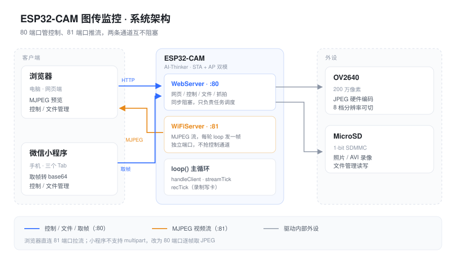
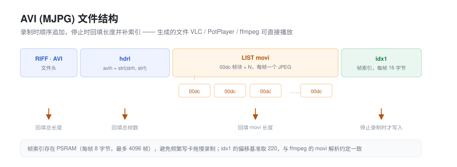

# ESP32-CAM 图传监控

基于 AI-Thinker ESP32-CAM（OV2640 + SD 卡）的一套完整方案，包含**固件**和**微信小程序**两个客户端。

- 固件用 Arduino IDE 开发，自带内嵌网页，浏览器打开就能看实时画面
- 小程序功能与网页端对齐，手机上随时查看和操作
- 两者共用同一块板子、同一套 HTTP 接口，控制项双向同步



## 功能

**实时画面**

- MJPEG 流推送，局域网延迟约 60~150ms
- 分辨率 8 档可调：QQVGA / CIF / VGA / SVGA / XGA / HD / SXGA / UXGA
- 画质、亮度、对比度可调，水平镜像、垂直翻转
- 补光灯（GPIO4）开关

**录屏**

- 录制为 MJPG 编码的 `.avi`，直接写入 SD 卡
- 电脑端 VLC / PotPlayer / ffmpeg 可直接播放
- 帧率 1~25fps 可选，上限 600 秒 / 200MB

**文件管理**

- SD 卡目录浏览、面包屑导航
- 下载、上传、重命名、删除、新建文件夹、清空
- 容量占用显示

**其它**

- STA（连路由器）+ AP（自发热点）双模同时在线
- 抓拍存手机相册 / 直接存 SD 卡
- 状态面板：IP、信号强度、可用内存、实时帧率、SD 容量

## 目录结构

```
ESP32CAM_WebStream/          固件（Arduino IDE 工程）
├── ESP32CAM_WebStream.ino   主程序：摄像头 / 网络 / 文件系统 / AVI 封装
├── web_page.h               内嵌网页（PROGMEM）
├── secrets.example.h        凭据模板 ← 复制成 secrets.h 再填
└── secrets.h                你的真实 WiFi 凭据（.gitignore 已排除）

ESP32CAM_MiniProgram/        微信小程序
├── pages/index/             监控：实时画面、抓拍、录屏、设备状态
├── pages/control/           调节：分辨率、画质、镜像翻转、补光
├── pages/files/             SD 卡文件管理
├── utils/api.js             设备通信层（host 持久化、取帧、请求封装）
├── images/                  tabBar 图标
└── project.config.example.json  ← 复制成 project.config.json 再填 AppID
```

## 快速开始

### 1. 固件

**环境准备**

- Arduino IDE，开发板管理器网址加 `https://espressif.github.io/arduino-esp32/package_esp32_index.json`
- 开发板选择 **AI Thinker ESP32-CAM**
- Partition Scheme：**Huge APP (3MB No OTA)**
- PSRAM：**Enabled**
- 已在 ESP32 core **2.0.9** 上验证编译通过

**填 WiFi 信息**

```bash
cd ESP32CAM_WebStream
cp secrets.example.h secrets.h    # Windows: copy secrets.example.h secrets.h
```

然后编辑 `secrets.h`，填入你的路由器 SSID 和密码。这个文件被 `.gitignore` 排除，不会被提交。

**烧录**

1. USB-TTL 接线：`5V→5V`、`GND→GND`、`TX→U0R`、`RX→U0T`
2. **GPIO0 接 GND**，按一下 RST，点上传
3. 传完拔掉 GPIO0，再按 RST
4. 串口 115200 会打印两个 IP 地址

**访问**

- 连板子热点 `ESP32-CAM` / `12345678`，打开 `http://192.168.4.1`
- 或者设备连上路由器后，用串口打印的那个 IP

> 供电建议 5V 2A 起步。图传电流峰值能到 300mA 以上，供电不足会花屏或反复重启。

### 2. 小程序

```bash
cd ESP32CAM_MiniProgram
cp project.config.example.json project.config.json
```

把 `project.config.json` 里的 `"appid"` 换成你自己的小程序 AppID，然后用微信开发者工具导入这个目录。

首次打开在页面顶部填写板子 IP（默认 `192.168.4.1`，走路由器时改成路由器分配的地址），回车生效，会存在本地。

**关于局域网访问的限制**：小程序只能请求 HTTPS + 白名单域名，直连 `http://192.168.x.x` 属于越界。所以：

- 开发者工具里需要勾选「不校验合法域名」（`project.config.json` 中 `urlCheck` 已设为 `false`）
- 真机必须用**开发版 / 体验版**，并在小程序详情页开启「开发调试」
- 正式发布版连不了局域网。要长期使用，需要给设备套一个 HTTPS 域名（frp / cpolar 内网穿透 + 证书），再把域名配进公众平台的 request / downloadFile / uploadFile 合法域名

## 技术说明

**为什么开两个端口**

ESP32 自带的 `WebServer` 是同步阻塞的。如果用它推 MJPEG 流，一旦开始推流 `handleClient()` 就不再返回，网页上的控制按钮会彻底失联。所以 80 端口只管网页和控制，81 端口用独立的 `WiFiServer` 推流，主循环每轮只发一帧。

**分辨率为什么按名字下发**

`framesize_t` 枚举在不同 ESP32 core 版本里顺序变过，传数字很容易错位。网页和小程序都传 `fs=VGA` 这样的名字，设备端映射到 `FRAMESIZE_VGA` 宏，跨版本稳定。

**AVI 封装**

标准 MJPG + AVI：`RIFF/AVI → hdrl → avih → strl → strh/strf → movi → idx1`。帧索引存在 PSRAM 里，停止录制时回填 RIFF 长度、总帧数、movi 长度，再追加 `idx1`。索引偏移基准取 220（`movi` fourcc 位置），与 ffmpeg 的解析约定一致。



**小程序为什么不用 MJPEG 流**

小程序不支持 `multipart/x-mixed-replace`。改用 `wx.request` 拉单帧 JPEG，转 base64 喂给 `<image>`。不用 `<image src="http://设备IP/capture">` 直连，是因为真机上该组件走微信自己的图片加载通道，对 ESP32 这种短连接 HTTP 服务经常一次都加载不出来。帧间隔限制在 90ms 左右，因为该版 `WebServer` 不支持 keep-alive，每帧一次短连接，发太快会堆 `TIME_WAIT` 耗尽 lwIP 连接池。

**控制项状态同步**

`/status` 返回传感器的真实回读值（`bri` / `con` / `hm` / `vf` / `led`），而不是本地变量。网页每秒轮询回填控件，小程序进页面后每 3 秒同步一次，所以任意一端改动另一端都能看到。

**内嵌网页必须放在独立头文件**

Arduino 的预处理会用 ctags 扫描 `.ino`，它不认 raw string，会把网页 JS 里的 `function xxx(){}` 当成 C++ 函数声明，在文件头插入非法原型导致编译失败。放进 `.h` 就完全避开扫描。

## 隐私说明

以下文件**不会**进入版本库，`.gitignore` 已排除：

| 文件 | 内容 |
|---|---|
| `ESP32CAM_WebStream/secrets.h` | 你的 WiFi SSID 和密码 |
| `ESP32CAM_MiniProgram/project.config.json` | 你的小程序 AppID |
| `ESP32CAM_MiniProgram/project.private.config.json` | 开发者工具私有配置 |
| `.workbuddy/` | 本地工作记录 |

仓库里提供的都是模板：`secrets.example.h`、`project.config.example.json`，需要自己复制改名后填写。

## 许可

MIT
